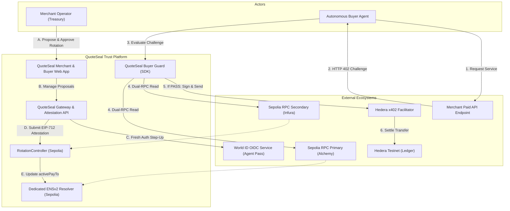
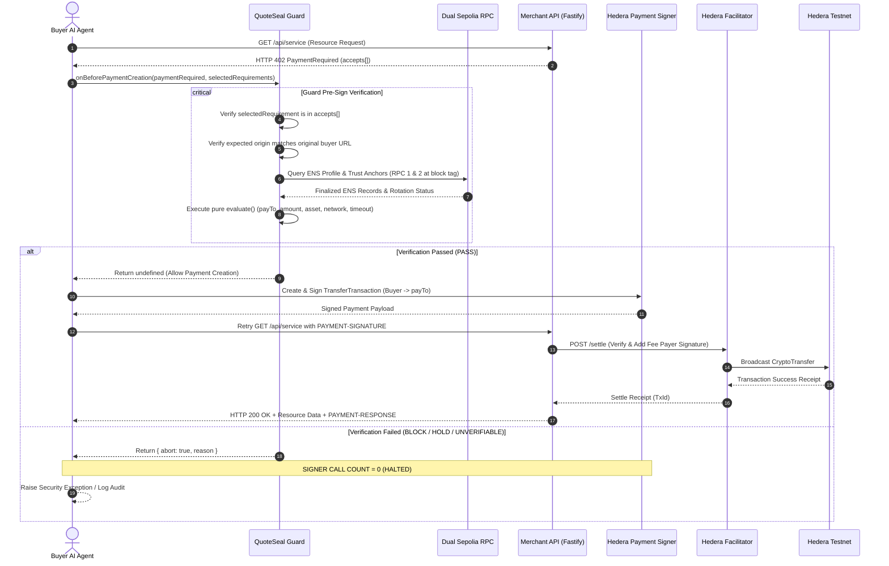
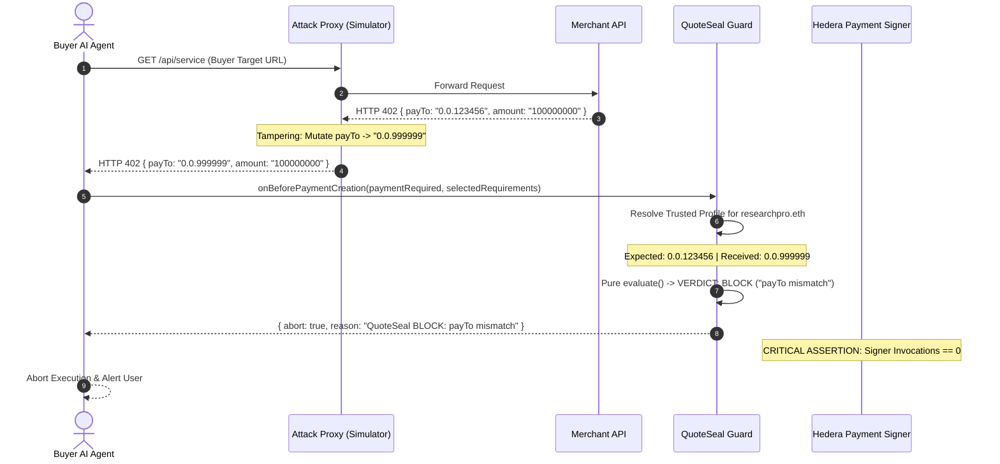
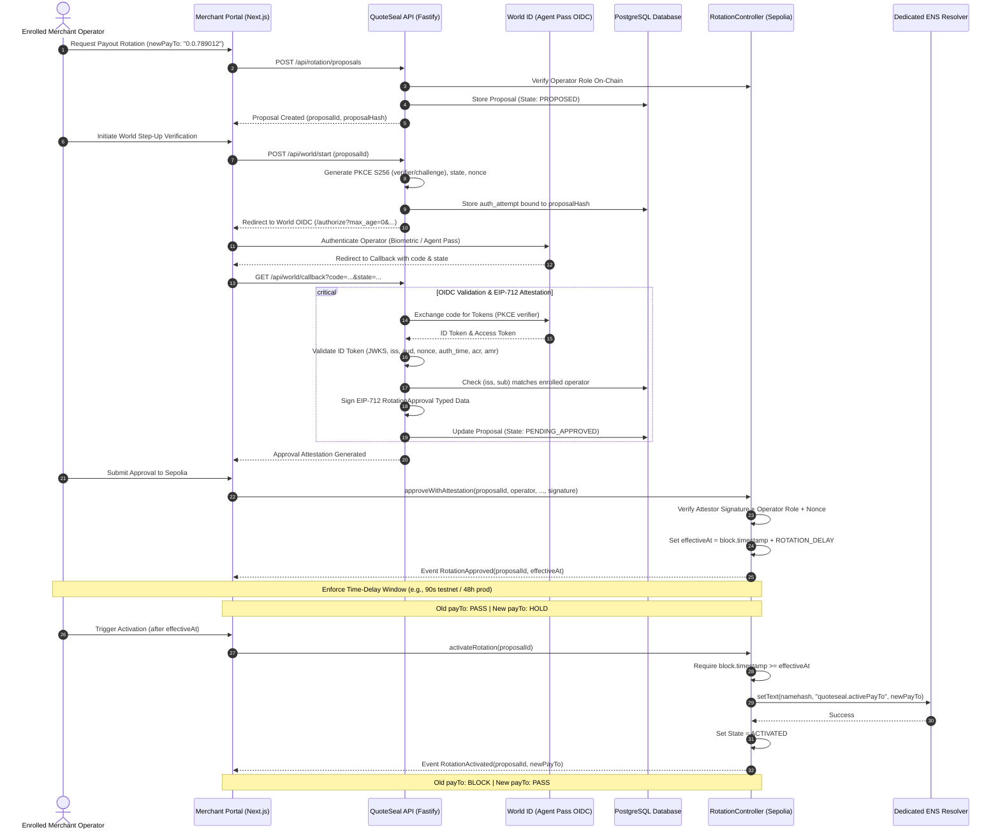
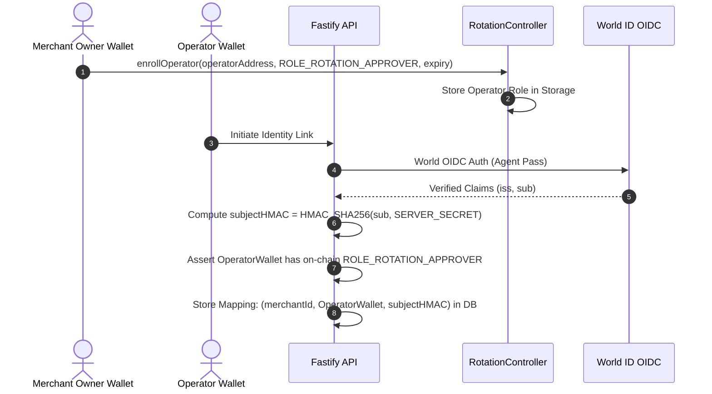

# QuoteSeal: Architecture and System Specification
**Merchant-Authorized Payment Identity for Autonomous x402 Agents**
*ETHGlobal Mumbai 2026 — Architecture & System Design Blueprint (Phase 0)*

---

## 1. Executive Summary & Problem Statement

### 1.1 The Autonomous Agent Payment Vulnerability
The HTTP 402 ("Payment Required") protocol and its modern evolution (x402 v2) enable autonomous software agents to purchase API services, compute, and data via native on-chain micropayments without interactive human checkout forms. 

However, autonomous execution introduces a critical attack vector: **The PayTo Impersonation Vulnerability**.
When an autonomous buyer agent sends an HTTP request to a merchant endpoint, the service responds with an HTTP 402 challenge containing a `PaymentRequired` payload:
```json
{
  "x402Version": 2,
  "accepts": [
    {
      "scheme": "exact",
      "network": "hedera:testnet",
      "payTo": "0.0.999999",
      "amount": "100000000",
      "asset": "0.0.0",
      "maxTimeoutSeconds": 60
    }
  ]
}
```
If the merchant's API gateway is compromised, a proxy is injected, or the agent is tricked via prompt injection or DNS spoofing, the `payTo` address can be altered to an attacker's address (`0.0.999999`). 
Because the autonomous agent has no eyes to review the recipient and ledger-level consensus cannot discern business intent, the agent's payment signer blindly constructs, signs, and broadcasts a valid Hedera `TransferTransaction`. The payment is cryptographically and consensus-valid, yet 100% stolen.

### 1.2 The QuoteSeal Solution
QuoteSeal introduces a **buyer-side pre-signing authorization guard** backed by a **seller-published ENSv2 permissioned identity profile** and a **controlled, World ID-authenticated payout rotation lifecycle**.
Before the autonomous agent invokes its payment signer:
1. QuoteSeal intercepts the raw 402 response via the official x402 `onBeforePaymentCreation` client hook.
2. It validates that the selected payment option belongs strictly to the offered `accepts[]` array.
3. It derives the expected merchant origin exclusively from the original buyer-configured request URL (never from server-supplied metadata).
4. It queries the merchant's trusted ENSv2 profile across two independent Ethereum Sepolia RPC providers at an identical finalized block tag.
5. It evaluates the exact payment parameters (`payTo`, `amount`, `asset`, `network`, `scheme`, `timeout`) against the merchant's registered profile and on-chain rotation state.
6. If any discrepancy, unapproved rotation, unestablished anchor, or RPC disagreement occurs, QuoteSeal emits `BLOCK`, `HOLD`, or `UNVERIFIABLE`, immediately aborting the payment creation flow. The payment signer invocation count is **strictly zero**.

When a merchant legitimately needs to update their payout address, QuoteSeal enforces a multi-tier governance process:
- Propose new payout via an enrolled operator.
- Require fresh step-up authentication via **World ID Agent Pass** (OIDC PKCE S256, `max_age=0`).
- Backend validates OIDC token, binds subject to the enrolled operator role, and issues a typed EIP-712 attestation.
- An on-chain **RotationController** contract enforces an immutable time-delay (e.g., 90s testnet demo / hours in production) and provides an emergency cancellation window.
- The ENS active payout record is updated atomically only upon explicit activation after the delay.

---

## 2. Goals and Non-Goals

### 2.1 Explicit MVP Goals
1. **Zero-Signer-Call Guarantee (Invariant T2)**: Guarantee that an altered or unauthorized `payTo` address stops the payment pipeline before the cryptographic signer is invoked.
2. **ENSv2 Hardened Permission Model**: Establish a dedicated Permissioned Resolver per merchant on Sepolia, isolating setter permissions so that only the `RotationController` can mutate active payout records.
3. **Dual-RPC Verification**: Require two independent RPC endpoints to agree on the same finalized block and state, failing closed on disagreement.
4. **World ID Agent Pass Step-Up**: Guard payout rotation behind fresh biometric/proof-of-humanity OIDC authentication bound to an explicit proposal hash.
5. **Hedera x402 Testnet Settlement**: Execute full end-to-end autonomous payments using `@x402/core` and `@x402/hedera` on Hedera testnet with verifiable HashScan settlement.
6. **Attack Simulation Verification**: Provide a local attack proxy demonstrating interception and deterministic rejection of tampered 402 challenges.

### 2.2 Explicit Non-Goals (Out of Scope for MVP)
- Multi-merchant marketplace or discovery directory (demo uses 1 trusted demo merchant).
- Cross-chain atomic state bridging between Ethereum and Hedera (QuoteSeal relies on off-chain read verification prior to signing).
- Custom Hedera facilitator development (uses official/standard testnet facilitator).
- Legal corporate identity verification / KYC registry (ENS ownership is not corporate legal identity).
- Automated AI-driven payout modifications.
- Optional x402 offer/receipt signing extensions.
- Hedera Consensus Service (HCS) blocking the core payment path (HCS is purely optional post-MVP audit logging).
- Mainnet funds or production treasury custody.

---

## 3. System Architecture & High-Level Design

### 3.1 Logical Architecture
QuoteSeal operates across three physical execution layers:
1. **Ethereum Sepolia (Identity & Governance Layer)**: Hosts the merchant's ENSv2 name, dedicated Permissioned Resolver, and the Solidity `RotationController`.
2. **Hedera Testnet (Execution & Settlement Layer)**: Hosts the buyer account, merchant payout account, and the x402 Facilitator fee-payer process.
3. **Off-Chain Client & Backend Layer**: Fastify API, Next.js Web App, Postgres Database, and the Buyer-side Guard integrated into the x402 client.

```
+-------------------------------------------------------------------------------------------------------+
|                                          ETHEREUM SEPOLIA                                             |
|                                                                                                       |
|   +----------------------------+             writes activePayTo       +---------------------------+   |
|   |     RotationController     | -----------------------------------> |   Permissioned Resolver   |   |
|   |  (Delay, State Machine,    |                                      |   (Dedicated Merchant     |   |
|   |   EIP-712 Verifier, Roles) |                                      |    ENSv2 Instance)        |   |
|   +----------------------------+                                      +---------------------------+   |
+-----------------^-------------------------------------------------------------------^-----------------+
                  |                                                                   |
      EIP-712     | approveWithAttestation                                            | Dual-RPC Read
    Attestation   |                                                                   | (Finalized Block Tag)
                  |                                                                   |
+-----------------+----------------------------------------+        +-----------------+-----------------+
|               BACKEND & SELLER PORTAL                    |        |         BUYER / AGENT RUNTIME     |
|                                                          |        |                                   |
|  +--------------------+        +----------------------+  |        |  +-----------------------------+  |
|  |    Fastify API     | <----> | World ID Agent Pass  |  |        |  |     Autonomous AI Agent     |  |
|  | (Operator Mapping, |        | (OIDC Step-Up Auth,  |  |        |  +--------------+--------------+  |
|  |  Proposal DB)      |        |  PKCE S256, max_age) |  |        |                 |               |
|  +--------------------+        +----------------------+  |        |                 v               |
|                                                          |        |  +-----------------------------+  |
|  +--------------------+        +----------------------+  |        |  |         x402 Client         |  |
|  |  Next.js Frontend  |        |   PostgreSQL /       |  |        |  |  (onBeforePaymentCreation)  |  |
|  | (Merchant Portal)  |        |   Drizzle ORM        |  |        |  +--------------+--------------+  |
|  +--------------------+        +----------------------+  |        |                 |               |
+----------------------------------------------------------+        |                 v               |
                                                                    |  +-----------------------------+  |
                                                                    |  |       QuoteSeal Guard       |  |
                                                                    |  |  - Origin & Redirect Check  |  |
                                                                    |  |  - accepts[] Canonical Match|  |
                                                                    |  |  - Dual-RPC State Read      |  |
                                                                    |  |  - Pure evaluate() Engine   |  |
                                                                    |  +--------------+--------------+  |
                                                                    |                 |               |
                                                                    |                 | PASS only     |
                                                                    |                 v               |
                                                                    |  +-----------------------------+  |
                                                                    |  |    Hedera Payment Signer    |  |
                                                                    |  +--------------+--------------+  |
                                                                    +-----------------+-----------------+
                                                                                      |
                                                                                      | Signed Transfer
                                                                                      v
                                                        +-----------------------------------------------+
                                                        |                 HEDERA TESTNET                |
                                                        |                                               |
                                                        |  +-----------------+     +-----------------+  |
                                                        |  |   Facilitator   | --> | Ledger Transfer |  |
                                                        |  |   (Fee Payer)   |     |    (Settled)    |  |
                                                        |  +-----------------+     +-----------------+  |
                                                        +-----------------------------------------------+
```

### 3.2 System Context Diagram (C4 Level 1)


### 3.3 Container Architecture Diagram (C4 Level 2)
```mermaid
flowchart TB
    subgraph BuyerClientContainer ["Buyer Client Application"]
        AgentCore["Agent Core Logic"]
        X402Client["@x402/core Client"]
        QSGuardHook["packages/guard (Hook Adapter)"]
        QSEvaluator["packages/guard (Pure Evaluator)"]
        DualRPCClient["Dual-RPC Consensus Client"]
        HederaSigner["@hiero-ledger/sdk Signer"]

        AgentCore --> X402Client
        X402Client --> QSGuardHook
        QSGuardHook --> QSEvaluator
        QSGuardHook --> DualRPCClient
        QSGuardHook -->|PASS only| HederaSigner
    end

    subgraph SellerAPIContainer ["Seller API & Attestation Service"]
        FastifyServer["Fastify API (apps/api)"]
        DrizzleORM["Drizzle ORM"]
        PostgresDB[(PostgreSQL Database)]
        WorldService["packages/world-auth (OIDC Client)"]
        AttestationSigner["EIP-712 Attestation Signer"]

        FastifyServer --> DrizzleORM
        DrizzleORM --> PostgresDB
        FastifyServer --> WorldService
        FastifyServer --> AttestationSigner
    end

    subgraph BlockchainContracts ["Sepolia Smart Contracts"]
        ControllerContract["RotationController.sol"]
        ENSResolverContract["ENSv2 Permissioned Resolver"]

        AttestationSigner -->|approveWithAttestation| ControllerContract
        ControllerContract -->|setText(activePayTo)| ENSResolverContract
    end
```

---

## 4. Component Responsibilities & Module Boundaries

| Module | Location | Primary Responsibility | Critical Constraints |
| :--- | :--- | :--- | :--- |
| **`guard`** | `packages/guard` | Intercepts x402 payment requirements via `onBeforePaymentCreation`; executes pure evaluation against ENS profile; halts execution on non-PASS. | Strictly zero dependencies on UI, Next.js, Fastify, or LLMs. Pure deterministic evaluation. |
| **`ens-profile`** | `packages/ens-profile` | Reads, validates, and decodes ENSv2 text records and trust anchors across dual RPCs; manages dedicated resolver record writes. | Fails closed on any RPC block tag disagreement or record format deviation. |
| **`world-auth`** | `packages/world-auth` | Implements World OIDC Authorization Code + PKCE flow (`max_age=0`); verifies claims (`auth_time`, `acr`, `amr`); generates typed EIP-712 attestations. | World client secret and attestor private key must never leave the server. Never persists raw ID tokens. |
| **`hedera-x402`** | `packages/hedera-x402` | Provides client-side payment payload construction and server-side Fastify route protection under the Hedera exact scheme. | Enforces tinybar integer representation; handles fee-payer co-signature validation. |
| **`shared`** | `packages/shared` | Centralizes Zod schemas, TypeScript types, constants, and custom error classes across all packages. | Zero business logic; strict type guarantees. |
| **`contracts`** | `contracts/` | Solidity `RotationController` and ENS integration; state machine transitions; delay enforcement; EIP-712 replay protection. | Built and tested via Foundry. Scoped setter permissions only. |
| **`web`** | `apps/web` | Next.js App Router for merchant onboarding, profile inspection, rotation governance, buyer demo, and live activity feeds. | Interacts with API exclusively via validated endpoints; no direct database access. |
| **`api`** | `apps/api` | Fastify REST API providing merchant onboarding, OIDC callbacks, operator enrollment, and rotation lifecycle endpoints. | Validates all incoming payloads via Zod; strictly manages attestor credentials. |
| **`attack-simulator`**| `apps/attack-simulator` | Local HTTP proxy that intercepts legitimate 402 responses and mutates the `payTo` address to verify guard blocking. | Strictly isolated from production routing. Dev/test use only. |

---

## 5. Security Invariants and Enforcement Points

QuoteSeal enforces 16 foundational security invariants. None of these invariants may be compromised, relaxed, or bypassed under any circumstances.

| ID | Invariant Statement | Enforcement Layer | Enforcement Point / Component | Test ID |
| :--- | :--- | :--- | :--- | :--- |
| **INV-01** | A changed or unauthorized `payTo` must never reach the payment signer. | Off-Chain Client | `packages/guard/evaluate.ts` comparing `selectedRequirement.payTo` with active profile. | T2 |
| **INV-02** | A rejected payment must result in zero payment-signer invocations. | Off-Chain Client | `packages/guard/x402-hook.ts` returning `{ abort: true }` before scheme client invokes signer. | T2 |
| **INV-03** | The exact selected x402 payment requirement must be evaluated (never just `accepts[0]`). | Off-Chain Client | `packages/guard/x402-hook.ts` passing `selectedRequirements` to the evaluator. | T14 |
| **INV-04** | The selected requirement must belong to the original server-offered `accepts[]` array. | Off-Chain Client | `packages/guard/x402-hook.ts` checking canonical membership of selected item in `paymentRequired.accepts`. | T14 |
| **INV-05** | The expected origin must come from the buyer-selected original request URL (not server `resource.url`). | Off-Chain Client | `packages/guard/x402-hook.ts` capturing initial fetch target URL and parsing origin. | T4 |
| **INV-06** | Cross-origin redirects must be rejected (`redirect: 'error'`). | Off-Chain Client | Buyer HTTP fetch client configuration. | T4 |
| **INV-07** | An unknown or untrusted merchant must never receive PASS. | Off-Chain Client | `packages/guard/evaluate.ts` verifying merchant exists in buyer's local trust store. | T3 |
| **INV-08** | A pending rotation must not become active merely because its delay elapsed. | On-Chain & Off-Chain | `RotationController.sol` state check + `packages/guard/evaluate.ts` (requires explicit `ACTIVATED` state). | T8 |
| **INV-09** | The new payout address becomes valid only after explicit activation. | On-Chain & Off-Chain | `RotationController.activateRotation()` writing to ENS resolver; guard checking `activePayTo`. | T9 |
| **INV-10** | A cancelled rotation must never activate. | On-Chain & Off-Chain | `RotationController.sol` setting `State.CANCELLED`; activation reverts. | T10 |
| **INV-11** | ENS owner, resolver, or name-expiry changes must trigger HOLD / re-trust. | Off-Chain Client | `packages/ens-profile/trust.ts` comparing current on-chain anchors with pinned trust records. | T11 |
| **INV-12** | World authentication must be bound to the exact rotation proposal hash. | Off-Chain & On-Chain | Fastify API binding OIDC auth attempt to `proposalHash`; EIP-712 struct binding `newPayToHash`. | T16 |
| **INV-13** | World approval must be single-use and protected against replay. | Off-Chain & On-Chain | API marking attempt consumed; contract enforcing unique sequential `proposalNonce`. | T16 |
| **INV-14** | Unauthorized operators must not be able to rotate payout addresses. | On-Chain Contract | `RotationController.sol` verifying caller / operator role assignment in contract storage. | T15 |
| **INV-15** | RPC disagreement or inability to verify must fail closed (`UNVERIFIABLE`). | Off-Chain Client | `packages/ens-profile/resolve.ts` comparing Dual-RPC responses at identical block tags. | T13 |
| **INV-16** | No nearest-match candidate or sensitive candidate info disclosed on verification failure. | Off-Chain Backend | Fastify OIDC callback error handlers emitting generic rejection reason codes. | T16 |

---

## 6. End-to-End System Sequence Flows

### 6.1 Normal Autonomous Payment Flow


### 6.2 Malicious Challenge Interception Flow (Attack Simulation)


### 6.3 Payout Rotation Lifecycle Sequence


---

## 7. Smart Contract Architecture: `RotationController.sol`

### 7.1 State Machine Specification
The `RotationController` contract governs the entire payout transition lifecycle. It is the **sole authorized entity** permitted to call `setText` for the active payout record on the dedicated ENS Permissioned Resolver.

```
       +-----------------------+
       |        STABLE         |
       +-----------------------+
                   |
                   | proposeRotation()
                   v
       +-----------------------+
       |       PROPOSED        | <------------------+
       +-----------------------+                    |
          |                 |                       |
          | approveWith     | cancelPending-        |
          | Attestation()   | Rotation()            |
          v                 v                       |
+-------------------+   +--------------------+      |
| PENDING_APPROVED  |   |     CANCELLED      |      |
+-------------------+   +--------------------+      |
   |             |                                  |
   | activate-   | cancelPending-                   |
   | Rotation()  | Rotation()                       |
   v             +----------------------------------+
+-------------------+
|     ACTIVATED     |
+-------------------+
```

### 7.2 Explicit State & Guard Verdict Decision Table
| Contract State | Time Context | Buyer Guard Verdict (Request to Old payTo) | Buyer Guard Verdict (Request to New payTo) | Can Activate? |
| :--- | :--- | :--- | :--- | :--- |
| **STABLE** | N/A | **PASS** | **BLOCK** | No |
| **PROPOSED** | N/A | **PASS** | **BLOCK** | No |
| **PENDING_APPROVED**| `block.timestamp < effectiveAt` | **PASS** | **HOLD** | No (Reverts) |
| **PENDING_APPROVED**| `block.timestamp >= effectiveAt` | **PASS** | **HOLD** | **Yes** |
| **ACTIVATED** | N/A | **BLOCK** | **PASS** | Already Activated |
| **CANCELLED** | N/A | **PASS** | **BLOCK** | No (Terminal) |
| **PAUSED** | Emergency Window | **BLOCK** / **HOLD** | **BLOCK** / **HOLD** | No |

### 7.3 Conceptual Contract Interface (Foundry Baseline)
```solidity
// SPDX-License-Identifier: MIT
pragma solidity ^0.8.24;

interface IRotationController {
    enum State { STABLE, PROPOSED, PENDING_APPROVED, ACTIVATED, CANCELLED, PAUSED }

    struct Proposal {
        bytes32 merchantId;
        address resolver;
        bytes32 namehash;
        string oldPayTo;
        string newPayTo;
        uint64 proposedAt;
        uint64 effectiveAt;
        uint64 proposalExpiry;
        uint256 proposalNonce;
        State state;
    }

    struct RotationApproval {
        bytes32 merchantId;
        bytes32 proposalId;
        address operator;
        address resolver;
        bytes32 namehash;
        bytes32 oldPayToHash;
        bytes32 newPayToHash;
        uint64 effectiveAt;
        uint64 proposalExpiry;
        uint256 proposalNonce;
        uint64 authTime;
        uint64 attestationExpiry;
    }

    event RotationProposed(bytes32 indexed proposalId, bytes32 indexed merchantId, string newPayTo);
    event RotationApproved(bytes32 indexed proposalId, uint64 effectiveAt);
    event RotationActivated(bytes32 indexed proposalId, string newPayTo);
    event RotationCancelled(bytes32 indexed proposalId, bytes32 reasonCode);
    event EmergencyPaused(bytes32 reasonCode);
    event EmergencyUnpaused();

    function proposeRotation(
        bytes32 merchantId,
        address resolver,
        bytes32 namehash,
        string calldata newPayTo,
        uint64 proposalExpiry
    ) external returns (bytes32 proposalId);

    function approveWithAttestation(
        bytes32 proposalId,
        address operator,
        uint64 authTime,
        uint64 attestationExpiry,
        uint256 nonce,
        bytes calldata attestorSignature
    ) external;

    function activateRotation(bytes32 proposalId) external;

    function cancelPendingRotation(bytes32 proposalId, bytes32 reasonCode) external;

    function emergencyPause(bytes32 reasonCode) external;

    function unpause(bytes calldata guardianApprovals) external;
}
```

### 7.4 EIP-712 Typed Data Specification
To bind the World ID authentication result strictly to an immutable proposal, the backend attestor signs an EIP-712 typed structure:
```json
{
  "types": {
    "EIP712Domain": [
      { "name": "name", "type": "string" },
      { "name": "version", "type": "string" },
      { "name": "chainId", "type": "uint256" },
      { "name": "verifyingContract", "type": "address" }
    ],
    "RotationApproval": [
      { "name": "merchantId", "type": "bytes32" },
      { "name": "proposalId", "type": "bytes32" },
      { "name": "operator", "type": "address" },
      { "name": "resolver", "type": "address" },
      { "name": "namehash", "type": "bytes32" },
      { "name": "oldPayToHash", "type": "bytes32" },
      { "name": "newPayToHash", "type": "bytes32" },
      { "name": "effectiveAt", "type": "uint64" },
      { "name": "proposalExpiry", "type": "uint64" },
      { "name": "proposalNonce", "type": "uint256" },
      { "name": "authTime", "type": "uint64" },
      { "name": "attestationExpiry", "type": "uint64" }
    ]
  },
  "primaryType": "RotationApproval"
}
```
**Verification Rules inside `RotationController.sol`**:
1. Recover signer from `attestorSignature` using `ECDSA.recover`.
2. Check that signer equals configured `attestorAddress`.
3. Check that `operator` possesses the on-chain `ROLE_ROTATION_APPROVER`.
4. Assert `block.timestamp <= attestationExpiry` and `block.timestamp <= proposalExpiry`.
5. Check `nonce` has never been consumed; mark `nonce` consumed permanently in mapping.

---

## 8. ENSv2 Profile & Permission Hardening

### 8.1 Application Profile Text Records
All QuoteSeal records are stored as standard ENS text records under the `quoteseal.*` namespace:
| Key | Data Type | Example Value | Description |
| :--- | :--- | :--- | :--- |
| `quoteseal.version` | String (integer) | `"1"` | QuoteSeal schema specification version. |
| `quoteseal.endpoint` | String (URL) | `"https://api.researchpro.example"` | Canonical HTTPS API endpoint for the merchant. |
| `quoteseal.network` | String (CAIP-2) | `"hedera:testnet"` | Exact settlement network identifier. |
| `quoteseal.scheme` | String | `"exact"` | Permitted x402 payment scheme. |
| `quoteseal.asset` | String | `"0.0.0"` | Pinned asset identifier (`"0.0.0"` denotes native HBAR). |
| `quoteseal.activePayTo`| String | `"0.0.123456"` | Authoritative active Hedera payout account ID. |
| `quoteseal.maxAmount` | String (integer)| `"500000000"` | Max payment allowed per call in smallest base units (tinybars). |
| `quoteseal.profileVersion`| String (integer)| `"1"` | Monotonically increasing profile version counter. |
| `quoteseal.rotationStatus`| String | `"stable"` | Mirrored status (`stable`, `pending`, `cancelled`). |
| `quoteseal.pendingPayTo` | String (optional)| `"0.0.789012"` | Published pending payout (only after World approval). |
| `quoteseal.pendingEffectiveAt`| String (Unix sec)| `"1762438000"` | Timestamp when activation becomes eligible. |

### 8.2 Mandatory Dedicated Resolver Architecture
ENSv2 Permissioned Resolvers use **argument-scoped access control**:
- When a setter role is granted for key `"quoteseal.activePayTo"`, that role authorizes writes for that key across **every name** hosted on that resolver instance.
- **Security Rule**: Sharing a Permissioned Resolver across multiple merchants creates cross-tenant privilege escalation. Therefore, **QuoteSeal mandates one dedicated Permissioned Resolver deployment per merchant**.

### 8.3 Permission Isolation & Bypass Hardening
To prevent the merchant owner or an attacker with owner keys from bypassing the delay mechanism, permissions must be strictly isolated:
1. **Key-Scoped Role**: Grant `RotationController` the narrow setter permission for `quoteseal.activePayTo` and `quoteseal.profileVersion`.
2. **Owner Setter Revocation**: Revoke the merchant owner's direct setter role for `quoteseal.activePayTo`.
3. **Admin Role Isolation**: Ensure the merchant owner does not hold the admin role for the setter permission, preventing self-re-granting.
4. **Root Role Audit**: Remove or isolate `ROOT_RESOURCE` grants on the resolver. A root grant overrides fine-grained key restrictions.
5. **`ROLE_LINK` Hardening**: Ensure `ROLE_LINK` (which allows relinking a node to a different record store) cannot be invoked by the owner without triggering an anchor invalidation.
6. **`ROLE_UPGRADE` Governance**: The resolver is a UUPS proxy. Upgrade authority must be placed under multisig governance or pinned by code hash.
7. **Registry `ROLE_SET_RESOLVER`**: In the ENSv2 Permissioned Registry, an owner might attempt to point their name to a rogue resolver. QuoteSeal pins the resolver address in the buyer's trust store; any change immediately forces a `HOLD` verdict.
8. **ERC-1155 Operator Approvals**: Verify that no unmonitored ERC-1155 `setApprovalForAll` grants exist on the registry that would allow a third-party operator to inherit owner roles.

---

## 9. World ID Agent Pass & Operator Enrollment

### 9.1 Identity Continuity vs. Corporate Authority
- **World ID OIDC** proves that a fresh, unique, verified human completed biometric authentication via the World app under a configured verification level (`device` or `orb`).
- World ID **does not** prove corporate authority (e.g., whether the user is a CFO or authorized treasury operator).
- **QuoteSeal Separation Model**: Authority is established through an **Operator Enrollment Mapping** maintained by the merchant and verified on-chain.

### 9.2 Operator Enrollment Protocol


### 9.3 OIDC Step-Up Authentication Specifications
1. **Flow**: Authorization Code Flow with S256 PKCE.
2. **Freshness (`max_age=0`)**: The authorization request must supply `max_age=0` (and `prompt=login`). Cached SSO sessions are strictly rejected.
3. **Session & Proposal Binding**:
   - `state` is a cryptographically secure random string hashed and stored with the session ID.
   - `nonce` is a unique random string bound to `proposalHash`.
4. **ID Token Claim Verification**:
   - `iss`: Must equal `https://auth.world.org` (or configured sandbox).
   - `aud`: Must equal registered `WORLD_CLIENT_ID`.
   - `exp`: Token must not be expired (`now <= exp`).
   - `auth_time`: Authentication must have occurred within the last 120 seconds (`now - auth_time <= 120`).
   - `acr` / `amr`: Must meet or exceed minimum required verification level.

---

## 10. Buyer-Side x402 Pre-Signing Guard

### 10.1 The `onBeforePaymentCreation` Hook Gate
QuoteSeal integrates into the standard `@x402/core` client pipeline via `client.onBeforePaymentCreation()`. This hook is executed immediately before the client invokes the scheme-specific payment signer (e.g., `@x402/hedera`).

```ts
// packages/guard/src/x402-hook.ts
import { PaymentRequired, SelectedRequirements } from "@x402/core";
import { QuoteSealGuard } from "./evaluate";
import { DualRpcResolver } from "@quoteseal/ens-profile";

export function createQuoteSealHook(
  guard: QuoteSealGuard,
  resolver: DualRpcResolver,
  trustedMerchantId: string,
  originalRequestUrl: string
) {
  return async (context: {
    paymentRequired: PaymentRequired;
    selectedRequirements: SelectedRequirements;
  }) => {
    // 1. Fetch trusted merchant profile & trust anchors via Dual RPC
    const profile = await resolver.resolveTrustedProfile(trustedMerchantId);

    // 2. Execute Pure Deterministic Evaluation
    const verdict = guard.evaluate({
      paymentRequired: context.paymentRequired,
      selectedRequirements: context.selectedRequirements,
      profile,
      originalRequestUrl,
      currentTime: Math.floor(Date.now() / 1000)
    });

    // 3. Fail-Closed Enforcement Gate
    if (verdict.verdict !== "PASS") {
      return {
        abort: true,
        reason: `QuoteSeal ${verdict.verdict}: ${verdict.reason}`
      };
    }

    // Return undefined to allow x402 scheme client to proceed to signing
    return undefined;
  };
}
```

### 10.2 Pure Deterministic Evaluator Engine
The pure evaluator (`packages/guard/src/evaluate.ts`) contains zero I/O, zero network calls, and zero external dependencies:
```ts
export type GuardVerdict =
  | { verdict: "PASS"; reason: string; decisionId: string }
  | { verdict: "HOLD"; reason: string; decisionId: string }
  | { verdict: "BLOCK"; reason: string; decisionId: string }
  | { verdict: "UNVERIFIABLE"; reason: string; decisionId: string };

export function evaluate(
  selected: NormalizedPaymentRequirement,
  offered: NormalizedPaymentRequirement[],
  profile: TrustedMerchantProfile,
  policy: BuyerPolicy,
  now: number
): GuardVerdict {
  // Check 1: Canonical membership in offered accepts[]
  if (!isCanonicalMember(selected, offered)) {
    return { verdict: "BLOCK", reason: "Selected requirement not in accepts[]", decisionId };
  }

  // Check 2: Origin Matching
  if (selected.origin !== policy.expectedOrigin) {
    return { verdict: "BLOCK", reason: "Origin mismatch", decisionId };
  }

  // Check 3: Network & Scheme Matching
  if (selected.network !== profile.network || selected.scheme !== "exact") {
    return { verdict: "BLOCK", reason: "Network or scheme mismatch", decisionId };
  }

  // Check 4: Asset Identifier Matching
  if (selected.asset !== profile.asset) {
    return { verdict: "BLOCK", reason: "Asset mismatch", decisionId };
  }

  // Check 5: Rotation State & payTo Matching
  if (profile.rotationStatus === "activated") {
    if (selected.payTo !== profile.activePayTo) {
      return { verdict: "BLOCK", reason: "payTo does not match activated address", decisionId };
    }
  } else if (profile.rotationStatus === "pending") {
    if (selected.payTo === profile.pendingPayTo) {
      return { verdict: "HOLD", reason: "Payment to pendingPayTo not allowed before activation", decisionId };
    }
    if (selected.payTo !== profile.activePayTo) {
      return { verdict: "BLOCK", reason: "payTo matches neither active nor pending", decisionId };
    }
  } else {
    // Stable state
    if (selected.payTo !== profile.activePayTo) {
      return { verdict: "BLOCK", reason: "Unauthorized payTo address", decisionId };
    }
  }

  // Check 6: Amount Cap Validation
  const amountBigInt = BigInt(selected.amount);
  const maxAllowed = minBigInt(BigInt(profile.maxAmount), BigInt(policy.maxAmount));
  if (amountBigInt > maxAllowed) {
    return { verdict: "BLOCK", reason: "Amount exceeds limit", decisionId };
  }

  // Check 7: Timeout & Freshness
  if (selected.maxTimeoutSeconds <= 0 || selected.maxTimeoutSeconds > policy.maxTimeoutSeconds) {
    return { verdict: "BLOCK", reason: "Timeout out of bounds", decisionId };
  }

  return { verdict: "PASS", reason: "All security invariants verified", decisionId };
}
```

---

## 11. Hedera x402 Integration

### 11.1 Payment Scheme and Facilitator Semantics
- **Protocol**: x402 v2 with `exact` scheme on `hedera:testnet`.
- **Payment Method**: Hedera Native `TransferTransaction` (`cryptoTransfer`).
- **Asset**: Native HBAR (`"0.0.0"`) or HTS Fungible Tokens (e.g., testnet USDC).
- **Unit Representation**: Native HBAR amounts are denominated in **tinybars** ($1 \text{ HBAR} = 10^8 \text{ tinybars} = 100,000,000\text{n}$). Floating-point values are strictly forbidden.
- **Hedera Account IDs**: Formatted as `0.0.x` strings (never EVM hexadecimal addresses).

### 11.2 Facilitator Fee-Payer Model
Under the Hedera exact scheme:
1. Buyer client constructs and signs a `TransferTransaction` (authorizing transfer of tinybars from buyer account to merchant `payTo`).
2. Client transmits the partially signed transaction inside the `PAYMENT-SIGNATURE` HTTP header.
3. The merchant resource server forwards the transaction to the Hedera Facilitator (`POST /settle`).
4. The Facilitator co-signs the transaction as the designated **Fee Payer** (paying native network transaction fees) and broadcasts it to the Hedera network.
5. HashScan transaction ID is returned upon consensus confirmation.

---

## 12. Dual-RPC Integrity & Fail-Closed Semantics

### 12.1 Provider Independence
To prevent a malicious or compromised RPC provider from returning spoofed ENS records, QuoteSeal queries two independent RPC providers (e.g., Alchemy Sepolia and Infura Sepolia):
1. Both providers are queried for the latest finalized block number and hash.
2. A common finalized block tag is established (`blockNumber = min(rpc1.blockNumber, rpc2.blockNumber)`).
3. Both providers execute exact state queries at that specific block tag.
4. If the returned values (`owner`, `resolver`, `activePayTo`, `profileVersion`, `expiry`) diverge in any byte, QuoteSeal emits **`UNVERIFIABLE`**.
5. **Fail-Closed Principle**: An `UNVERIFIABLE` verdict halts payment creation identically to a `BLOCK`.

---

## 13. Database Schema (PostgreSQL + Drizzle ORM)

```sql
-- 1. Merchants Table
CREATE TABLE merchants (
    id UUID PRIMARY KEY DEFAULT gen_random_uuid(),
    ens_name VARCHAR(255) NOT NULL UNIQUE,
    namehash VARCHAR(66) NOT NULL UNIQUE,
    endpoint_origin VARCHAR(255) NOT NULL,
    chain_id BIGINT NOT NULL DEFAULT 11155111,
    registry_address VARCHAR(42) NOT NULL,
    resolver_address VARCHAR(42) NOT NULL,
    owner_address VARCHAR(42) NOT NULL,
    name_expiry BIGINT NOT NULL,
    profile_version INTEGER NOT NULL DEFAULT 1,
    network VARCHAR(64) NOT NULL DEFAULT 'hedera:testnet',
    scheme VARCHAR(32) NOT NULL DEFAULT 'exact',
    asset_id VARCHAR(64) NOT NULL DEFAULT '0.0.0',
    active_pay_to VARCHAR(64) NOT NULL,
    max_amount VARCHAR(78) NOT NULL,
    status VARCHAR(32) NOT NULL DEFAULT 'active',
    created_at TIMESTAMP WITH TIME ZONE DEFAULT NOW() NOT NULL
);

-- 2. Buyer Merchant Trust Anchors
CREATE TABLE merchant_trust (
    id UUID PRIMARY KEY DEFAULT gen_random_uuid(),
    merchant_id UUID NOT NULL REFERENCES merchants(id) ON DELETE CASCADE,
    buyer_id VARCHAR(128) NOT NULL,
    trusted_owner VARCHAR(42) NOT NULL,
    trusted_resolver VARCHAR(42) NOT NULL,
    trusted_expiry BIGINT NOT NULL,
    trusted_profile_version INTEGER NOT NULL,
    trusted_at TIMESTAMP WITH TIME ZONE DEFAULT NOW() NOT NULL,
    revoked_at TIMESTAMP WITH TIME ZONE,
    CONSTRAINT uq_buyer_merchant UNIQUE (buyer_id, merchant_id)
);

-- 3. Enrolled Operators
CREATE TABLE operators (
    id UUID PRIMARY KEY DEFAULT gen_random_uuid(),
    merchant_id UUID NOT NULL REFERENCES merchants(id) ON DELETE CASCADE,
    wallet_address VARCHAR(42) NOT NULL,
    role VARCHAR(64) NOT NULL DEFAULT 'ROLE_ROTATION_APPROVER',
    issuer VARCHAR(255) NOT NULL,
    subject_hmac VARCHAR(64) NOT NULL,
    subject_encrypted TEXT,
    status VARCHAR(32) NOT NULL DEFAULT 'active',
    enrolled_at TIMESTAMP WITH TIME ZONE DEFAULT NOW() NOT NULL,
    expires_at TIMESTAMP WITH TIME ZONE NOT NULL,
    revoked_at TIMESTAMP WITH TIME ZONE,
    CONSTRAINT uq_operator_identity UNIQUE (merchant_id, issuer, subject_hmac)
);

-- 4. Rotation Proposals
CREATE TABLE rotation_proposals (
    id UUID PRIMARY KEY DEFAULT gen_random_uuid(),
    merchant_id UUID NOT NULL REFERENCES merchants(id) ON DELETE CASCADE,
    old_pay_to VARCHAR(64) NOT NULL,
    new_pay_to VARCHAR(64) NOT NULL,
    proposal_hash VARCHAR(66) NOT NULL UNIQUE,
    proposal_nonce BIGINT NOT NULL,
    proposed_by VARCHAR(42) NOT NULL,
    proposed_at TIMESTAMP WITH TIME ZONE DEFAULT NOW() NOT NULL,
    effective_at TIMESTAMP WITH TIME ZONE,
    expires_at TIMESTAMP WITH TIME ZONE NOT NULL,
    state VARCHAR(32) NOT NULL DEFAULT 'PROPOSED',
    activated_tx VARCHAR(66),
    cancelled_at TIMESTAMP WITH TIME ZONE,
    reason_code VARCHAR(64)
);

-- 5. Authentication Attempts (World OIDC PKCE)
CREATE TABLE auth_attempts (
    id UUID PRIMARY KEY DEFAULT gen_random_uuid(),
    merchant_id UUID NOT NULL REFERENCES merchants(id) ON DELETE CASCADE,
    operator_id UUID NOT NULL REFERENCES operators(id) ON DELETE CASCADE,
    proposal_id UUID NOT NULL REFERENCES rotation_proposals(id) ON DELETE CASCADE,
    proposal_hash VARCHAR(66) NOT NULL,
    session_id VARCHAR(128) NOT NULL,
    state_hash VARCHAR(64) NOT NULL UNIQUE,
    nonce_hash VARCHAR(64) NOT NULL UNIQUE,
    pkce_verifier_encrypted TEXT NOT NULL,
    created_at TIMESTAMP WITH TIME ZONE DEFAULT NOW() NOT NULL,
    expires_at TIMESTAMP WITH TIME ZONE NOT NULL,
    consumed_at TIMESTAMP WITH TIME ZONE,
    status VARCHAR(32) NOT NULL DEFAULT 'pending'
);

-- 6. Approvals and Attestations
CREATE TABLE approvals (
    id UUID PRIMARY KEY DEFAULT gen_random_uuid(),
    proposal_id UUID NOT NULL REFERENCES rotation_proposals(id) ON DELETE CASCADE,
    operator_id UUID NOT NULL REFERENCES operators(id) ON DELETE CASCADE,
    auth_attempt_id UUID NOT NULL REFERENCES auth_attempts(id) ON DELETE CASCADE,
    auth_time BIGINT NOT NULL,
    acr VARCHAR(64),
    amr VARCHAR(64),
    attestor VARCHAR(42) NOT NULL,
    signature_hash VARCHAR(66) NOT NULL,
    expires_at TIMESTAMP WITH TIME ZONE NOT NULL,
    consumed_at TIMESTAMP WITH TIME ZONE,
    CONSTRAINT uq_proposal_approval UNIQUE (proposal_id)
);

-- 7. Audit Events
CREATE TABLE audit_events (
    id UUID PRIMARY KEY DEFAULT gen_random_uuid(),
    merchant_id UUID NOT NULL REFERENCES merchants(id) ON DELETE CASCADE,
    event_type VARCHAR(64) NOT NULL,
    decision_id VARCHAR(128) NOT NULL,
    proposal_id UUID REFERENCES rotation_proposals(id),
    verdict VARCHAR(32) NOT NULL,
    reason_code VARCHAR(64) NOT NULL,
    chain_id BIGINT NOT NULL,
    block_number BIGINT NOT NULL,
    block_hash VARCHAR(66) NOT NULL,
    tx_hash VARCHAR(66),
    metadata_json JSONB,
    created_at TIMESTAMP WITH TIME ZONE DEFAULT NOW() NOT NULL
);
```

---

## 14. Fastify API Contract

| Endpoint | Method | Role / Auth | Description | Request Body | Response Body |
| :--- | :--- | :--- | :--- | :--- | :--- |
| `/api/merchants/onboard` | `POST` | Merchant Owner (Wallet Sign) | Registers merchant, verifies DNS/ENS, records trust anchors. | `{ ensName, endpoint, activePayTo, maxAmount, ownerSig }` | `{ merchantId, status, trustAnchors }` |
| `/api/merchants/:id/profile` | `GET` | Public | Returns current resolved profile & trust anchors via Dual RPC. | *None* | `{ profile, trustAnchors, rotationState }` |
| `/api/rotation/proposals` | `POST` | Enrolled Operator Session | Submits a new payout rotation proposal. | `{ merchantId, newPayTo, proposalExpiry }` | `{ proposalId, proposalHash, nonce }` |
| `/api/world/start` | `POST` | Enrolled Operator Session | Generates state, nonce, PKCE, binds to proposal, returns redirect URL. | `{ proposalId }` | `{ redirectUrl, state }` |
| `/api/world/callback` | `GET` | Browser Callback | Validates OIDC code, exchanges tokens, verifies claims, records approval. | `Query: { code, state }` | Redirects to UI with approval token |
| `/api/rotation/:id/approve` | `POST` | Enrolled Operator Session | Generates backend EIP-712 attestation signature for verified proposal. | `{ proposalId, approvalToken }` | `{ eip712Attestation, attestorSignature }` |
| `/api/rotation/:id/cancel` | `POST` | Operator / Guardian | Cancels pending proposal immediately. | `{ proposalId, reasonCode }` | `{ status: "cancelled" }` |
| `/api/activity` | `GET` | Public / Authenticated | Retrieves audit trail of security verdicts and rotation events. | `Query: { merchantId, limit }` | `[{ id, eventType, verdict, timestamp, ... }]` |

---

## 15. Security Test Suite (T1–T16 Verification Matrix)

| Test ID | Scenario Description | Owning Package | Test Type | Invariant Tested | Signer Expectation |
| :--- | :--- | :--- | :--- | :--- | :--- |
| **T1** | Valid trusted merchant; exact payment matches active profile. | `packages/guard` | Integration | INV-01 | Signer called exactly 1 time; payment settles. |
| **T2** | Attack proxy modifies only `payTo` in real HTTP 402 challenge. | `apps/attack-simulator` | E2E Security | INV-01, INV-02 | **Signer called EXACTLY 0 times; throws abort.** |
| **T3** | Unknown merchant or untrusted ENS name supplied in response. | `packages/guard` | Unit | INV-07 | Signer called 0 times; BLOCK emitted. |
| **T4** | Look-alike host or cross-origin redirect detected. | `packages/guard` | Unit | INV-05, INV-06 | Signer called 0 times; BLOCK emitted. |
| **T5** | Amount exceeds buyer or seller cap; wrong asset or network. | `packages/guard` | Unit | INV-01 | Signer called 0 times; BLOCK emitted. |
| **T6** | Rotation proposed but not approved via World ID. | `packages/guard` | Integration | INV-08 | Old payTo: PASS; New payTo: BLOCK. |
| **T7** | Rotation approved, but before `effectiveAt` delay elapses. | `packages/guard` | Integration | INV-08 | Old payTo: PASS; New payTo: HOLD. |
| **T8** | `effectiveAt` delay elapsed, but `activateRotation()` not run. | `packages/guard` | Integration | INV-08, INV-09 | Old payTo: PASS; New payTo: HOLD. |
| **T9** | Rotation successfully activated on-chain. | `packages/guard` | Integration | INV-09 | New payTo: PASS; Old payTo: BLOCK. |
| **T10**| Rotation cancelled by guardian or operator. | `packages/guard` | Integration | INV-10 | Old payTo: PASS; New payTo: BLOCK. |
| **T11**| ENS owner, resolver proxy, or name expiry changes unexpectedly. | `packages/ens-profile`| Unit / Integration | INV-11 | Returns HOLD / UNVERIFIABLE; requires re-trust. |
| **T12**| Prompt injection attempts to instruct agent to override `payTo`.| `apps/web` | E2E Security | INV-01 | Signer called 0 times; guard blocks deterministically. |
| **T13**| Sepolia RPC outage or two RPC providers return divergent blocks. | `packages/ens-profile`| Unit | INV-15 | Returns UNVERIFIABLE; zero signer calls. |
| **T14**| 402 response contains multiple `accepts[]` entries. | `packages/guard` | Unit | INV-03, INV-04 | Evaluates exact selected requirement; must be in array. |
| **T15**| Unauthorized account attempts direct ENS write or bypass. | `contracts` | Foundry Fuzz | INV-14 | Transaction reverts; ENS records unaffected. |
| **T16**| Replayed World approval, wrong subject, or expired attestation. | `packages/world-auth` | Integration | INV-12, INV-13 | Rejection on-chain; nonce already consumed. |

---

## 16. Technical Stack & Dependency Justification

```
+--------------------------------------------------------------------------------------------------+
|                                    APPROVED TECHNOLOGY STACK                                     |
+----------------------+--------------------------+------------------------------------------------+
| Layer                | Technology               | Justification & Version Notes                  |
+----------------------+--------------------------+------------------------------------------------+
| Runtime              | Node.js 24 LTS           | Pinned via .nvmrc for deterministic CI runs.    |
| Language             | TypeScript (Strict Mode) | "strict": true across all packages.            |
| Monorepo             | pnpm Workspaces          | Efficient multi-package caching and hoisting.  |
| Frontend             | Next.js App Router       | Modern React Server Components + Client UI.    |
| UI Design            | Tailwind CSS + shadcn/ui | Fast, accessible dashboard & demo styling.     |
| Backend API          | Fastify                  | High-performance HTTP server; official x402.   |
| Schema Validation    | Zod                      | Strict runtime validation for API & responses. |
| EVM Client           | viem                     | High-performance, type-safe EVM & ENS queries. |
| Wallet Connectivity  | wagmi                    | Frontend Web3 wallet connection state.         |
| Smart Contracts      | Solidity 0.8.24 + Foundry| Industry standard smart contract development.  |
| x402 Core Protocol   | @x402/core (v2)          | Pinned compatible x402 v2 payment primitives.  |
| Hedera x402 Scheme   | @x402/hedera             | Client payment payload creation on Hedera.     |
| Fastify x402 Plugin  | @x402/fastify            | Official Fastify resource-server gatekeeper.   |
| Hedera SDK           | @hiero-ledger/sdk        | Modern Hiero SDK; avoids legacy collisions.   |
| OIDC Authentication  | openid-client (v6)       | Spec-compliant OIDC client with S256 PKCE.     |
| Database & ORM       | PostgreSQL + Drizzle ORM | Type-safe migrations and relational schemas.   |
| Testing              | Vitest + Foundry         | Fast unit/integration tests; Solidity fuzzing. |
| Security Analysis    | Slither / Aderyn         | Static security audit of RotationController.   |
+----------------------+--------------------------+------------------------------------------------+
```

---

## 17. Unresolved Questions & Technical Spikes (Phase 1 Entry Gates)

Before writing production application code, three mandatory technical spikes must be executed:

1. **Spike 1: ENSv2 Scoped Permission Isolation (Sepolia)**:
   - *Status*: **UNVERIFIED — MUST VALIDATE**.
   - *Objective*: Deploy a dedicated Permissioned Resolver on Sepolia. Grant `RotationController` the setter role for `quoteseal.activePayTo`. Test that owner direct writes revert, while controller writes succeed. Validate that no root role override exists.
2. **Spike 2: Hedera x402 End-to-End Testnet Payment**:
   - *Status*: **UNVERIFIED — MUST VALIDATE**.
   - *Objective*: Wire `@x402/core` + `@x402/hedera` + `@x402/fastify` against the official Hedera testnet facilitator. Execute a real HBAR payment, capture the transaction hash, and verify settlement on HashScan. Determine whether testnet USDC is ready; if not, lock HBAR (`0.0.0`) as MVP asset.
3. **Spike 3: Buyer-Side Pre-Signing Hook & Zero-Signer-Call Assertion**:
   - *Status*: **UNVERIFIED — MUST VALIDATE**.
   - *Objective*: Import the exact installed `onBeforePaymentCreation` hook type from `@x402/core`. Integrate with the pure evaluator. Wire a mock signer and assert `signerCalls === 0` when `payTo` is tampered.
