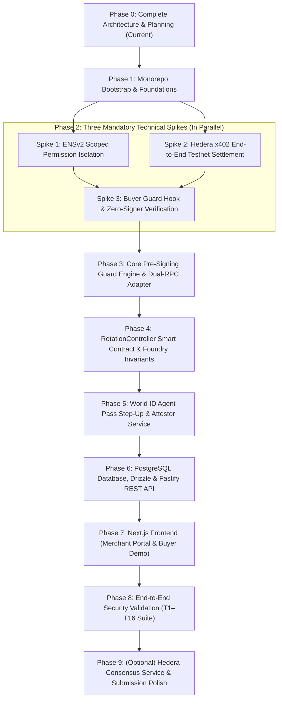

# QuoteSeal: Implementation Roadmap & Phased Execution Plan
**Version 1.0 — Architecture Baseline (Phase 0 Planning)**

---

## 1. Roadmap Overview & Build Philosophy

QuoteSeal follows a strict **Spike-First, Eval-Driven Build Order**:
1. **Never build UI first**: Do not build dashboards, mock pages, or marketing surfaces before the cryptographic and protocol integrations are proven.
2. **Three Mandatory Technical Spikes**: Spikes 1, 2, and 3 are absolute prerequisite gates before implementing core business logic.
3. **Fail-Closed Verification Gates**: Every phase requires automated test coverage and explicit security review sign-off before progressing to subsequent phases.
4. **Planning-Only Enforcement**: Phase 0 establishes the blueprint. Implementation begins strictly in Phase 1 upon user authorization and reconciliation with Codex.



---

## 2. Phase-by-Phase Execution Plan

### Phase 0: Project Analysis, Architecture Planning & Repository Setup (CURRENT)
- **Goal**: Read entire specification, verify threat model, extract 16 security invariants, design system architecture, generate ADRs, create empty folder structure.
- **Deliverables**:
  - `architecture.md`
  - `docs/implementation-roadmap.md`
  - `docs/security-architecture.md`
  - `docs/technical-decisions.md`
  - `docs/open-questions.md`
  - `docs/agent-work-allocation.md`
  - Proposed empty folder structure created.
- **Exit Gate**: All documents reviewed and reconciled with Codex; explicit user authorization received to start Phase 1 coding.
- **Sign-Off Agent**: Antigravity (Author) & Codex (Independent Reviewer).

---

### Phase 1: Monorepo Bootstrap, Tooling & Environment Foundations
- **Goal**: Initialize reproducible TypeScript monorepo with strict linting, typechecking, Foundry compilation, and environment variable schema validation.
- **Dependencies**: Phase 0 sign-off.
- **Key Tasks**:
  1. Initialize git repository (`git init`).
  2. Create `.nvmrc` pinning Node.js `24.x`.
  3. Create root `package.json` with `"packageManager": "pnpm@9.x"`.
  4. Create `pnpm-workspace.yaml` configuring `apps/*` and `packages/*`.
  5. Setup root `tsconfig.base.json` with `"strict": true`, `"noImplicitAny": true`, `"exactOptionalPropertyTypes": true`.
  6. Configure Vitest root config and Github Actions CI workflow.
  7. Initialize Foundry project under `contracts/` with `foundry.toml` (cancun/prague EVM version, Sepolia RPC config).
  8. Create `.env.example` defining all required configuration variables.
- **Acceptance Criteria**:
  - `pnpm install` completes cleanly with frozen lockfile.
  - `pnpm -r typecheck` passes across all empty packages.
  - `forge build` compiles standard contracts without warnings.
  - CI workflow runs and passes on branch push.
- **Security Review Gate**: Review root dependencies; ensure zero untrusted or extraneous packages.

---

### Phase 2: The Three Mandatory Technical Spikes (Proof-of-Concept Gates)

#### Spike 1: ENSv2 Scoped Permission Isolation (Sepolia)
- **Goal**: Prove on Ethereum Sepolia that a dedicated Permissioned Resolver can grant narrow setter permission to an external controller while preventing owner direct writes.
- **Status**: **UNVERIFIED — MUST VALIDATE**.
- **Tasks**:
  1. Deploy one dedicated Permissioned Resolver instance on Sepolia via the official Verifiable Factory.
  2. Configure `quoteseal.activePayTo` and test profile records.
  3. Grant a mock controller address the key-scoped setter role for `quoteseal.activePayTo`.
  4. Revoke or isolate the merchant owner's alternate setter/admin path.
  5. Execute write transactions from:
     - Owner wallet (Expect: Revert / Unauthorized).
     - Unrelated wallet (Expect: Revert / Unauthorized).
     - Controller wallet (Expect: Success).
  6. Inspect effective root roles, `ROLE_LINK`, `ROLE_UPGRADE`, and registry `ROLE_SET_RESOLVER`.
- **Exit Gate / Pass Condition**: Only the intended controller can update the payout record on-chain.

#### Spike 2: Hedera x402 End-to-End Testnet Settlement
- **Goal**: Prove autonomous payment execution using `@x402/core` and `@x402/hedera` on Hedera testnet through the official facilitator.
- **Status**: **UNVERIFIED — MUST VALIDATE**.
- **Tasks**:
  1. Wire a minimal Fastify server exposing a paid route protected by `@x402/fastify` under the Hedera exact scheme.
  2. Inspect facilitator `/supported` endpoint for fee payer account and network capabilities.
  3. Wire an autonomous buyer client with `@x402/hedera` and funded testnet account.
  4. Test HBAR payment (`asset = "0.0.0"`, amounts in tinybars).
  5. Verify facilitator co-signs as fee payer and transaction achieves consensus.
  6. Inspect testnet USDC token association; if unconfirmed, establish HBAR as the demo asset.
- **Exit Gate / Pass Condition**: One real testnet payment completes end-to-end; capture transaction ID and HashScan URL in documentation.

#### Spike 3: Buyer-Side Pre-Signing Hook & Zero-Signer-Call Gate
- **Goal**: Prove that the official `@x402/core` `onBeforePaymentCreation` hook can intercept payment requirements and abort execution before the payment signer is invoked.
- **Status**: **UNVERIFIED — MUST VALIDATE**.
- **Tasks**:
  1. Inspect installed `@x402/core` hook signatures and verify return type contract.
  2. Implement a mock signer with an invocation counter:
     ```ts
     let signerCalls = 0;
     const mockSigner = {
       createPaymentPayload: async (req) => {
         signerCalls++;
         return realSigner.createPaymentPayload(req);
       }
     };
     ```
  3. Connect hook to mock evaluator.
  4. Test valid challenge: Verify payment succeeds and `signerCalls === 1`.
  5. Test tampered `payTo` challenge: Verify hook returns `{ abort: true }`, request fails, and `signerCalls === 0`.
- **Exit Gate / Pass Condition**: Automated test proves `signerCalls === 0` on tampered payload.

---

### Phase 3: Core Pre-Signing Guard Engine & Dual-RPC Adapter
- **Goal**: Implement the production-grade buyer guard package (`packages/guard`) and ENS profile resolver (`packages/ens-profile`).
- **Dependencies**: Spike 1 & Spike 3 passed.
- **Key Tasks**:
  1. Implement pure deterministic `evaluate()` in `packages/guard/evaluate.ts`.
  2. Implement canonical `isCanonicalMember()` for verifying selected requirement belongs to `accepts[]`.
  3. Implement strict URL and origin parsing from buyer-selected request target.
  4. Implement Dual-RPC adapter in `packages/ens-profile/resolve.ts`:
     - Query Primary (Alchemy) & Secondary (Infura) at identical finalized block tag.
     - Assert byte-for-byte agreement on `owner`, `resolver`, `expiry`, and `activePayTo`.
     - Return `UNVERIFIABLE` on any timeout or discrepancy.
  5. Implement trust anchor verification in `packages/ens-profile/trust.ts`.
- **Acceptance Criteria**: 100% unit test coverage on `evaluate()` covering all edge cases (T3, T4, T5, T13, T14).

---

### Phase 4: RotationController Smart Contract & Foundry Invariant Tests
- **Goal**: Implement, test, and audit the Solidity `RotationController.sol` contract and ENS resolver integration.
- **Dependencies**: Spike 1 passed.
- **Key Tasks**:
  1. Implement `contracts/src/RotationController.sol`:
     - Explicit state machine: `STABLE`, `PROPOSED`, `PENDING_APPROVED`, `ACTIVATED`, `CANCELLED`, `PAUSED`.
     - Replay-protected proposal nonces.
     - EIP-712 typed signature verification using OpenZeppelin `ECDSA` and `EIP712`.
     - Scoped `setText` invocation on dedicated ENS resolver upon activation.
     - Emergency cancellation and pause mechanisms.
  2. Write comprehensive Foundry tests (`contracts/test/RotationController.t.sol`):
     - State transition unit tests.
     - Delay enforcement tests (`activateRotation` reverts if `block.timestamp < effectiveAt`).
     - Fuzz testing of proposal nonces and signatures.
     - Invariant tests: active payout never changes without valid World attestation and elapsed delay.
  3. Run Slither / Aderyn static analysis and remediate any findings.
- **Acceptance Criteria**: All Foundry unit, fuzz, and invariant tests pass; zero Slither high/medium warnings.

---

### Phase 5: World ID Agent Pass Step-Up & Attestor Service
- **Goal**: Implement World OIDC Authorization Code + PKCE integration, operator enrollment mapping, and backend EIP-712 attestation signing in `packages/world-auth`.
- **Dependencies**: Phase 4 contract ABI defined.
- **Key Tasks**:
  1. Configure `openid-client` (v6) with World ID issuer (`https://auth.world.org`).
  2. Implement OIDC Authorization Code + S256 PKCE initiation with `max_age=0`.
  3. Implement OIDC callback validator:
     - Verify JWKS token signature, `iss`, `aud`, `exp`, `nonce`.
     - Assert `auth_time` freshness (within 120s).
     - Assert `acr`/`amr` verification level.
  4. Implement operator enrollment mapping:
     - Map (issuer, subject_hmac) to enrolled operator wallet.
     - Check on-chain operator role on `RotationController`.
  5. Implement EIP-712 `RotationApproval` attestation signer with server-held private key.
  6. Implement single-use state/nonce consumption in Postgres.
- **Acceptance Criteria**: Integration test demonstrates valid OIDC callback produces valid EIP-712 signature accepted by `RotationController.approveWithAttestation()`.

---

### Phase 6: PostgreSQL Database, Drizzle & Fastify REST API
- **Goal**: Implement durable database schemas and REST API endpoints in `apps/api`.
- **Dependencies**: Phase 3, 4, 5.
- **Key Tasks**:
  1. Define Drizzle schema for `merchants`, `merchant_trust`, `operators`, `auth_attempts`, `rotation_proposals`, `approvals`, `audit_events`.
  2. Run initial Drizzle migration on PostgreSQL.
  3. Implement Fastify server and routes:
     - `/api/merchants/onboard` (with owner signature verification).
     - `/api/merchants/:id/profile` (with Dual-RPC resolution).
     - `/api/rotation/proposals` (proposal creation).
     - `/api/world/start` & `/api/world/callback` (OIDC step-up).
     - `/api/rotation/:id/approve` (EIP-712 attestation issuance).
     - `/api/rotation/:id/cancel` (emergency cancellation).
     - `/api/activity` (audit log).
  4. Enforce strict Zod schema validation across all request/response bodies.
  5. Apply security middleware: CORS restriction, rate-limiting, secure headers.
- **Acceptance Criteria**: All API endpoints pass automated integration tests against test PostgreSQL database.

---

### Phase 7: Next.js Frontend (Merchant Portal & Buyer Demo)
- **Goal**: Implement responsive, accessible Next.js App Router frontend in `apps/web`.
- **Dependencies**: Phase 6 API operational.
- **Key Tasks**:
  1. Setup Tailwind CSS + shadcn/ui components.
  2. Implement Merchant Dashboard:
     - Profile view showing active ENS records, trust anchors, and rotation status.
     - Operator enrollment interface.
     - Payout rotation wizard: propose new payTo, initiate World ID Agent Pass step-up, countdown timer for delay, explicit activation button.
  3. Implement Buyer Agent Demo Interface:
     - Interactive simulation panel.
     - Toggle attack simulator (normal vs tampered payTo).
     - Live execution log showing QuoteSeal verdict, Dual-RPC agreement, HashScan settlement link, and signer invocation count.
  4. Implement Audit Activity Timeline.
- **Acceptance Criteria**: End-to-end interactive flows function cleanly; wallet connectivity works via wagmi; World OIDC redirects and returns smoothly.

---

### Phase 8: End-to-End Security Validation (T1–T16 Suite)
- **Goal**: Execute the full security test suite verifying all 16 security invariants across the integrated system.
- **Dependencies**: All components integrated.
- **Key Tasks**:
  1. Execute tests T1 through T16:
     - **T1**: Valid payment PASS -> Hedera settlement -> HashScan confirmed.
     - **T2**: Attack proxy mutates payTo -> BLOCK -> **Signer calls == 0**.
     - **T3**: Unknown merchant -> BLOCK -> Signer calls == 0.
     - **T4**: Cross-origin redirect -> BLOCK -> Signer calls == 0.
     - **T5**: Exceeded amount cap -> BLOCK -> Signer calls == 0.
     - **T6**: Proposed but unapproved rotation -> Old PASS, New BLOCK.
     - **T7**: Approved rotation before delay -> Old PASS, New HOLD.
     - **T8**: Delay elapsed but unactivated -> Old PASS, New HOLD.
     - **T9**: Activated rotation -> New PASS, Old BLOCK.
     - **T10**: Cancelled rotation -> Old PASS, New BLOCK.
     - **T11**: Tampered ENS resolver/owner/expiry -> HOLD/UNVERIFIABLE.
     - **T12**: Prompt injection attack -> BLOCK -> Signer calls == 0.
     - **T13**: Dual-RPC disagreement -> UNVERIFIABLE -> Signer calls == 0.
     - **T14**: Multiple accepts[] -> Evaluates exact selected requirement.
     - **T15**: Unauthorized ENS write attempt -> Reverts on-chain.
     - **T16**: Replayed World ID approval -> Contract reverts on nonce replay.
  2. Document test execution results with raw logs and transaction proofs.
- **Acceptance Criteria**: 16/16 tests pass deterministically.

---

### Phase 9: Optional Hedera Consensus Service & Submission Packaging
- **Goal**: Add optional audit trail via HCS, deploy to production hosting, and prepare ETHGlobal submission deliverables.
- **Dependencies**: Phase 8 passed.
- **Key Tasks**:
  1. Optional: Implement HCS logger in `packages/hedera-x402` publishing SHA-256 hashes of security verdicts to a dedicated topic.
  2. Deploy Next.js to Vercel (public HTTPS URL).
  3. Deploy Fastify API to Railway / Render (public HTTPS callback for World OIDC).
  4. Deploy PostgreSQL database to Neon / Supabase.
  5. Deploy contracts to Sepolia and record deployed addresses in README.
  6. Record 3–4 minute demo video demonstrating normal flow, attack proxy blocking, and World-authenticated rotation.
  7. Finalize submission README with partner prize alignment (ENS, Hedera, World).
- **Acceptance Criteria**: Public production deployment live, demo video recorded, ETHGlobal Mumbai submission submitted.
