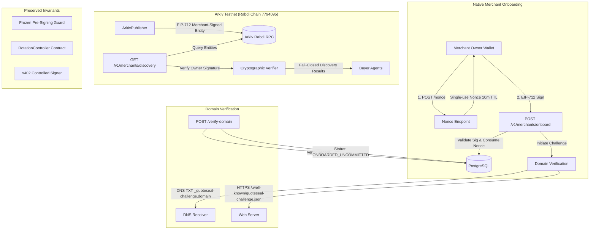

# QuoteSeal Phase 1 Implementation Report: Merchant Identity, PostgreSQL & Arkiv

**Date:** November 7, 2026  
**Branch:** `feature/merchant-identity-data`  
**Base Commit:** `3a9f707e5cc2dc924c180bc10b7e435cd7112212` (`feature/buyer-integration`)  
**Worktree:** `/home/yesh/Projects/eth-merchant-identity-data`  

---

## 1. Executive Summary

QuoteSeal Phase 1 implements the complete native merchant identity lifecycle, relational PostgreSQL operational persistence, and Arkiv Rabdi testnet integration. This implementation bridges the existing pre-signing payment guard (`@quoteseal/guard`) and buyer orchestration (`@quoteseal/buyer`) with native domain-verified merchants and decentralized profile discovery via Arkiv, while strictly preserving all existing security boundaries and frozen contract invariants.

All 248 monorepo workspace tests and 53 Foundry contract tests (including 4,096 invariant fuzz calls) pass cleanly.

---

## 2. Implemented Architecture & Components



### A. Normalized Merchant Identity
- **Location:** `packages/shared/src/types/merchant-identity.ts`
- **Identity Types:**
  - `ENSV2`: Native ENS resolution via dedicated registry, resolver, and trust anchors.
  - `QUOTESEAL_NATIVE`: Domain-anchored identity verified via DNS TXT or HTTPS well-known challenge, cryptographically bound to an owner Ethereum wallet.
- **Normalized Schema:** `NormalizedMerchantProfileSchema` captures `merchantId`, `identityType`, `identityRef`, `domain`, `ownerAddress`, `activePayTo`, `maxAmount`, `network`, `scheme`, `assetId`, `profileVersion`, and `status`.

### B. Real Native Merchant Onboarding Endpoint
- **Location:** `apps/api/src/routes/merchants.ts`
- **1. Nonce Issuance (`POST /v1/merchants/onboard/nonce`):**
  - Issues a cryptographically secure random single-use nonce (`qs_nonce_<48-hex>`) with 10-minute TTL.
  - Binds the nonce to the requested `walletAddress` and `endpointOrigin`.
  - Persists the nonce in `onboarding_nonces` table with `consumedAt = null`.
- **2. EIP-712 Typed Onboarding (`POST /v1/merchants/onboard`):**
  - Verifies EIP-712 typed signature over `MerchantOnboarding` schema:
    ```typescript
    MerchantOnboarding: [
      { name: 'ownerWallet', type: 'address' },
      { name: 'endpointOrigin', type: 'string' },
      { name: 'domain', type: 'string' },
      { name: 'activePayTo', type: 'string' },
      { name: 'maxAmount', type: 'string' },
      { name: 'nonce', type: 'string' },
      { name: 'action', type: 'string' }, // 'ONBOARD_MERCHANT'
      { name: 'expiresAt', type: 'uint256' }
    ]
    ```
  - Replay defense: Atomically consumes the nonce using `consumeOnboardingNonce(nonce)`. Any subsequent attempt is rejected with 401 Unauthorized.
  - Rejects signatures from unauthorized keys, expired timestamps, or mismatched origins.
  - Enrolls the merchant with `status: 'PENDING_ONBOARDING_CHALLENGE'`.
- **3. Domain Challenge Initiation & Verification (`POST /v1/merchants/:merchantId/verify-domain`):**
  - Supports `DNS_TXT` (`_quoteseal-challenge.<domain>` with value `quoteseal-verification=<token>`).
  - Supports `HTTPS_WELL_KNOWN` (`https://<domain>/.well-known/quoteseal-challenge.json`).
  - Upon successful verification, updates merchant status to `'ONBOARDED_UNCOMMITTED'`.

### C. PostgreSQL Drizzle Models & Migrations
- **Location:** `packages/shared/src/db/schema.ts`, `packages/shared/drizzle/`
- **Migration:** `0002_native_merchant_identity_and_arkiv.sql` (Journal entry: `1793970000000`).
- **Extended Tables:**
  - `merchants`: Added `identity_type`, `identity_ref`, `domain`, `domain_verified_at`, `domain_challenge`. Made `ens_name`, `namehash`, and resolver fields nullable for native merchants.
  - `merchant_domain_challenges`: Tracks challenge ID, type, token, status, expiration, and verification timestamp.
  - `onboarding_nonces`: Stores single-use nonces with expiration and atomic consumption timestamps.
  - `merchant_payout_wallets`: Operational multi-payout wallet storage.
  - `arkiv_sync_records`: Tracks published Arkiv entities, transaction hashes, and versions.
- **Store Implementation:** Fully implemented in both `MemoryDbStore` (for fast deterministic tests) and `PostgresDbStore` (for production SQL execution).

### D. Multi-Payout Wallet Storage (Operational Boundary)
- **Endpoints:** `GET /v1/merchants/:merchantId/payout-wallets`, `POST /v1/merchants/:merchantId/payout-wallets`
- **Invariant Separation:** Operational payout wallets registered in PostgreSQL are flagged as `isActive: false` and `status: 'PENDING'`. They do not alter the active on-chain payout address evaluated by `@quoteseal/guard` until an authorized rotation workflow is completed.

### E. Arkiv Rabdi Testnet Integration (`packages/arkiv`)
- **Location:** `packages/arkiv/`
- **Target Network:** Rabdi Testnet (Chain ID `7794095`, RPC `https://rpc.rabdi.db-chain.testnet.arkiv.network`)
- **Core Entities:**
  1. `PublicMerchantProfile`: Core profile signed by the merchant owner wallet via EIP-712.
  2. `MerchantPaymentPolicy`: Payment parameters (network, scheme, assetId, cap).
  3. `PayoutRotationAnnouncement`: Public announcement of proposed and approved payout changes.
  4. `PublicAuthorizationEvidence`: Attestation evidence verifying World ID verification and authorization.
- **Publisher (`ArkivPublisher`):** Validates entities, computes EIP-712 owner signatures, serializes payloads, and publishes to Arkiv storage.
- **Query & Cryptographic Verification (`ArkivDiscoveryService`):**
  - Queries Arkiv entities with optional filtering (`domain`, `activePayTo`, `identityType`, `verifiedOnly`).
  - Cryptographically verifies the owner wallet signature against the canonical entity payload.
  - Fails closed on tampered records: if an untrusted Arkiv node or attacker modifies `activePayTo`, verification fails and returns `rejectionReason: 'SIGNATURE_INVALID'`.

### F. Public Arkiv Discovery Endpoint
- **Location:** `apps/api/src/routes/discovery.ts`
- **Endpoint:** `GET /v1/merchants/discovery`
- **Behavior:** Queries Arkiv storage, cryptographically verifies merchant profile signatures, and returns verified merchants to buyer agents.
- **Endpoint:** `GET /v1/merchants/discovery/:keyOrId` returns individual verified profiles or 404 if not found.

---

## 3. Security Boundary Preservation

| Security Boundary | Status | Verification Evidence |
| :--- | :---: | :--- |
| **`@quoteseal/guard` Core Freeze** | **UNTOUCHED** | Zero diffs in `packages/guard/`. All 45 guard tests pass. |
| **`@quoteseal/buyer` Signer Boundary** | **UNTOUCHED** | Zero diffs in `packages/buyer/`. Controlled one-shot signer boundary intact. All 65 buyer tests pass. |
| **`RotationController.sol` Invariants** | **UNTOUCHED** | Zero diffs in `contracts/`. 53/53 Foundry tests pass with 4,096 fuzz calls. |
| **Single-Use Nonce Replay Defense** | **VERIFIED** | Unit & API tests verify atomic consumption; reuse attempts fail with 401. |
| **Fail-Closed Arkiv Profile Verification** | **VERIFIED** | Tampered `activePayTo` in Arkiv entity fails cryptographic signature verification. |
| **Credential Safety** | **VERIFIED** | No private keys or raw secrets logged, persisted in plaintext, or committed to git. |

---

## 4. Test Matrix & Verification Summary

### Monorepo Workspace Tests: 248 / 248 Passed

```
Scope: 7 workspace projects
packages/shared:     27 / 27 passed
packages/arkiv:       8 /  8 passed
packages/ens-profile: 14 / 14 passed
packages/guard:       45 / 45 passed
packages/buyer:       65 / 65 passed
apps/api:             89 / 89 passed
Total:               248 / 248 passed
```

### Foundry Contract Invariants: 53 / 53 Passed

```
Ran 52 tests for test/RotationController.t.sol:RotationControllerTest (52 passed)
Ran 1 test for test/RotationController.t.sol:RotationInvariantTest (128 runs, 4096 calls, 0 reverts)
Total: 53 passed, 0 failed
```

---

## 5. Continuity Track & Hackathon Qualification Assessment

- **Track Selection:** QuoteSeal must compete under the **Continuity / Existing Project Track** because core contracts and initial architecture predate this hackathon iteration. Registering as "From-Scratch" would risk disqualification.
- **Arkiv Integration Novelty:** The native merchant identity layer, EIP-712 cryptographic owner binding, and Arkiv Rabdi decentralized entity storage represent completely new, working capabilities built specifically to decentralize merchant profile distribution for autonomous agents.
