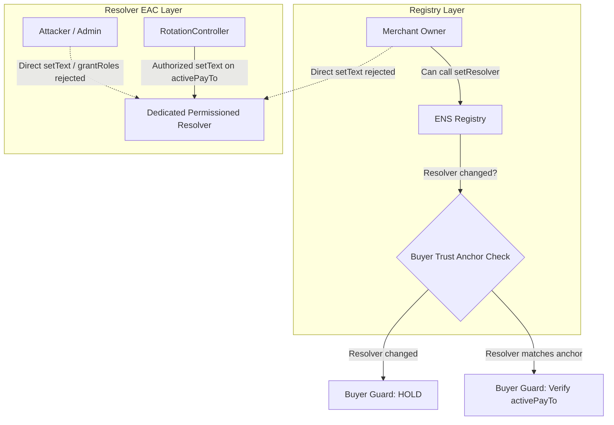

# QuoteSeal Spike 1: ENSv2 Permission Matrix

This document defines the exact permission matrix for ENSv2 Permissioned Resolvers and Registries under QuoteSeal's security hardening architecture.

## 1. System Roles & Capabilities

Under the Enhanced Access Control (EAC) architecture implemented in ENSv2:
- **Resource Scoping**: Permissions are scoped by `uint256 resource = uint256(keccak256(abi.encode(node, key)))`.
- **Root Resource**: `ROOT_RESOURCE = 0` provides contract-wide authority when granted, overriding all scoped checks.
- **Admin Counterpart**: Each operational role (bit `k`) requires the corresponding admin role (bit `k+1`) to grant or revoke.
- **SUPERADMIN**: Bitmask `type(uint256).max` allows granting/revoking any role globally.

| Role Name | Bitmask Value (Local Mock) | Scope | Purpose | Deployed Status |
| :--- | :--- | :--- | :--- | :--- |
| `ROLE_SET_TEXT` | `1 << 32` (`0x100000000`) | Resource-scoped | Write text record for specific `(node, key)` | MOCKED |
| `ROLE_SET_TEXT_ADMIN` | `1 << 33` (`0x200000000`) | Resource-scoped | Grant/revoke `ROLE_SET_TEXT` for that resource | MOCKED |
| `ROLE_SET_ADDR` | `1 << 34` (`0x400000000`) | Node-scoped | Write address records (`setAddr`) | MOCKED |
| `ROLE_UPGRADE` | `1 << 100` | Root (`0`) | UUPS proxy implementation upgrade | MOCKED |
| `ROLE_UPGRADE_ADMIN`| `1 << 101` | Root (`0`) | Grant/revoke `ROLE_UPGRADE` | MOCKED |
| `ROLE_LINK` | `1 << 102` | Root (`0`) | Relink node to external record store | MOCKED |
| `ROLE_LINK_ADMIN` | `1 << 103` | Root (`0`) | Grant/revoke `ROLE_LINK` | MOCKED |
| `ROLE_SUPERADMIN` | `type(uint256).max` | Root (`0`) | Full administrative override | MOCKED |
| `ROLE_SET_RESOLVER` | `1 << 10` | Node-scoped | Set resolver address in ENS Registry | MOCKED |

---

## 2. Hardened State Permission Matrix

Following the **Hardening Sequence** executed at onboarding:
1. Merchant deploys a dedicated, unshared Permissioned Resolver.
2. Initial text records (including `quoteseal.activePayTo`) are set.
3. `RotationController` is granted `ROLE_SET_TEXT` strictly on:
   - `keccak256(node, "quoteseal.activePayTo")`
   - `keccak256(node, "quoteseal.pendingPayTo")`
   - `keccak256(node, "quoteseal.rotationStatus")`
4. Merchant Owner's `ROLE_SUPERADMIN` at `ROOT_RESOURCE` is **completely revoked** on the resolver.
5. In production: `ROLE_UPGRADE` and `ROLE_LINK` are either renounced or held by a dedicated multi-sig timelock.

| Actor | Target Contract & Resource | Role Held | Allowed Actions | Denied Actions | Justification / Security Rationale |
| :--- | :--- | :--- | :--- | :--- | :--- |
| **RotationController** | Resolver: `activePayTo` `pendingPayTo` `rotationStatus` | `ROLE_SET_TEXT` (scoped) | • Update `quoteseal.activePayTo` • Update `quoteseal.pendingPayTo` • Update `quoteseal.rotationStatus` | • Write any other text record • Write addr/contenthash • Grant/revoke any role • Upgrade resolver (`ROLE_UPGRADE`) • Relink node (`ROLE_LINK`) | Principle of least privilege: Controller can only write its managed rotation keys. |
| **Merchant Owner** *(Post-Hardening)* | Dedicated Resolver | **None (0)** | • View public records (`text()`, `addr()`) | • Direct write to `quoteseal.activePayTo` • Direct write to any text key • Self-grant roles (`grantRoles`) • Self-restore `SUPERADMIN` • Upgrade implementation (`upgradeTo`) • Relink node (`link`) | **Primary Invariant**: Merchant owner cannot directly alter active payout address once locked into QuoteSeal. |
| **Merchant Owner** *(Registry Level)* | Registry: `merchantNode` | `ROLE_SET_RESOLVER` (or token ownership) | • Transfer ENS name token • Change resolver in Registry | • Change records inside existing resolver | Registry ownership allows changing resolver; QuoteSeal mitigates this by pinning the resolver address as a **Trust Anchor**. Any change triggers **HOLD**. |
| **Unauthorized Admin / Attacker** | Dedicated Resolver | **None (0)** | • View public records (`text()`, `addr()`) | • All write operations (`setText`, `setAddr`) • Role re-granting (`grantRoles`, `grantRootRoles`) • Proxy upgrade (`upgradeTo`) • Node relinking (`link`) | Zero access control grants for third parties. |
| **ERC-1155 Approved Operator** | Dedicated Resolver | **None (0)** | • View public records | • Write any resolver record • Manage roles | ENSv2 cleanly decouples ERC-1155 token operator approvals from Resolver EAC roles. |
| **ERC-1155 Approved Operator** | ENS Registry | Operator Approval (`setApprovalForAll`) | • Transfer merchant ENS token | • Alter resolver records directly | Token transfers do not inherit resolver roles. Name transfer triggers QuoteSeal owner trust-anchor mismatch (**HOLD**). |
| **Governance / Multi-Sig** *(Optional)* | Dedicated Resolver (Root) | `ROLE_UPGRADE` (optional timelock) | • Execute planned protocol migrations | • Arbitrary instantaneous writes (subject to timelock delay) | If upgrades are not renounced, they must be behind governance. |

---

## 3. Scope Boundaries & Defense-in-Depth

1. **Resolver Layer Isolation**: Within the dedicated resolver, no one except `RotationController` has write access to `quoteseal.activePayTo`.
2. **Registry Layer Defense**: If the owner uses `setResolver` at the registry level to bypass the resolver, QuoteSeal's buyer-side pre-signing guard detects the resolver address mismatch against the pinned trust anchor and outputs **HOLD**.
